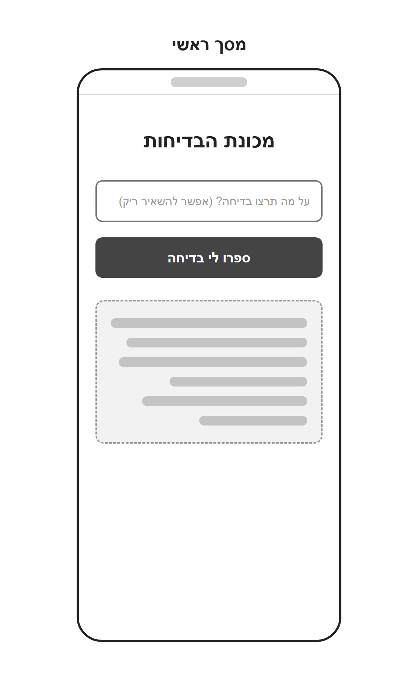
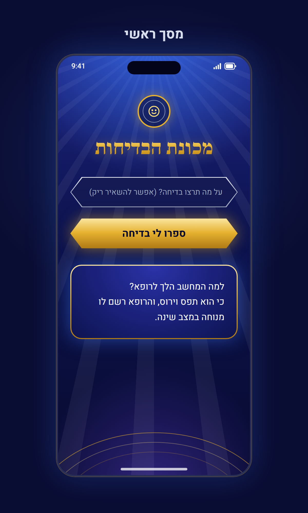
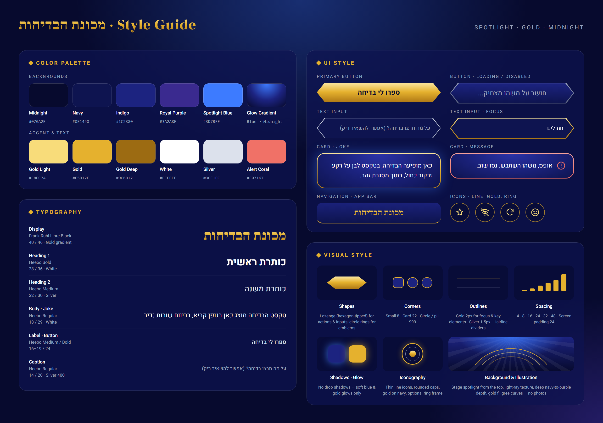

# DESIGN – מכונת הבדיחות

מסמך זה מתאר את המימוש העיצובי של האפליקציה. הוא מתבסס על:
- [PRD.md](PRD.md): דרישות המוצר והתנהגות המסך.
- `wireframes.png`: מבנה המסך.
- `style-guide.png`: השפה העיצובית.
- `mockups.png`: המראה הסופי.

---

## 1. Screens – מסכי האפליקציה

לאפליקציה יש **מסך אחד**: "מסך ראשי".

| Wireframe | Mockup |
|---|---|
|  |  |

### 1.1 מסך ראשי

**מטרת המסך:** המשתמש מקליד נושא, או משאיר את התיבה ריקה, ומקבל בדיחה שמוצגת באותו מסך.

**מבנה ותוכן:** עמודה אחת ממורכזת, ברוחב מלא פחות שוליים של 24px מכל צד. הרכיבים מלמעלה למטה:

| # | רכיב | תוכן | עיצוב |
|---|---|---|---|
| 1 | סמל (Emblem) | פרצוף מחייך בקו | עיגול 64px עם מסגרת זהב 2.5px וטבעת פנימית כסופה דקה, זוהר זהב. רכיב דקורטיבי בלבד שמופיע ב-Mockup ולא ב-Wireframe, ואין לו פעולה |
| 2 | כותרת | **מכונת הבדיחות** | סגנון Display: גרדיאנט זהב, ממורכז |
| 3 | תיבת טקסט | Placeholder: **על מה תרצו בדיחה? (אפשר להשאיר ריק)** | Text Input בצורת Lozenge, גובה 56px |
| 4 | כפתור | **ספרו לי בדיחה** | Primary Button בצורת Lozenge, גובה 58px, זוהר זהב |
| 5 | אזור התוצאה | טקסט הבדיחה | Card · Joke עם מסגרת זהב וזוהר כחול |

- המרווח האנכי בין הרכיבים הוא 22px. מעל אזור התוצאה יש מרווח נוסף של 10px.
- מתחת לאזור התוצאה נשאר שטח רקע פנוי. בתחתית המסך יש קשתות זהב דקורטיביות (ראו 2.4).
- התוכן מתחיל מתחת לשורת הסטטוס של המכשיר, עם ריווח עליון של כ-30px.

**מצבי אזור התוצאה:** ה-Wireframes וה-Mockups מציגים רק את המצב שבו מוצגת בדיחה. העיצוב של שאר המצבים לקוח מרכיבי ה-Style Guide:

| מצב | תצוגה |
|---|---|
| לפני הבקשה הראשונה | אזור התוצאה לא מוצג |
| טעינה | הכפתור מוחלף בסגנון **Button · Loading / Disabled** עם הטקסט **חושב על משהו מצחיק...** |
| בדיחה | **Card · Joke** עם טקסט הבדיחה |
| שגיאה | **Card · Message** עם אייקון התראה והודעה: **אין חיבור לאינטרנט. בדקו את החיבור ונסו שוב.** או **אופס, משהו השתבש. נסו שוב.** |

**פעולות וניווט:**
- הקלדה בתיבת הטקסט. בזמן הקלדה התיבה בסגנון **Text Input · Focus**.
- לחיצה על הכפתור, או על Enter, שולחת בקשה. בדיחה חדשה מחליפה את הבדיחה הקודמת באותו כרטיס.
- אין מעבר למסכים אחרים.

### 1.2 מבנה הניווט

אין ניווט בין מסכים. כל האינטראקציה מתבצעת במסך הראשי, ואין תפריטים, לשוניות או כפתור חזרה. האפליקציה נפתחת ישירות במסך הזה, גם בדפדפן וגם כאפליקציה מותקנת (PWA). רכיב ה-**App Bar** שמופיע ב-Style Guide לא משמש במסך, כי הכותרת מוצגת בגוף המסך.

---

## 2. Style Guide – השפה העיצובית

**האווירה הכללית:** במת שעשועון טלוויזיוני בערב. רקע כחול-סגול עמוק, זרקור כחול שיורד מלמעלה, הדגשות בזהב מבריק ופרטים בכסף. התחושה חגיגית ודרמטית, אבל הממשק נשאר פשוט וקריא.

### 2.1 Color Palette

**רקעים:**

| שם | HEX | שימוש |
|---|---|---|
| Midnight | `#070A2E` | תחתית הרקע, טקסט על כפתור זהב |
| Navy | `#0E1450` | רקע של שדות קלט ושל תחתית כרטיסים |
| Indigo | `#1C2380` | ראש הרקע ומרכז הכרטיסים |
| Royal Purple | `#3A2A8F` | זוהר סגול בתחתית המסך |
| Spotlight Blue | `#3D7BFF` | זרקור בראש המסך וזוהר סביב כרטיסים |

**הדגשות וטקסט:**

| שם | HEX | שימוש |
|---|---|---|
| Gold Light | `#F8DC7A` | החלק העליון של גרדיאנט הזהב, אייקונים |
| Gold | `#E5B12E` | צבע הזהב הראשי: מסגרות, הדגשות, זוהר |
| Gold Deep | `#9C6B12` | החלק התחתון של גרדיאנט הזהב |
| White | `#FFFFFF` | טקסט הבדיחה וכותרות משנה |
| Silver | `#DCE1EC` | מסגרות שדות, טקסט משני |
| Silver 400 | `#9AA3BC` | Placeholder, טקסט מושבת, טבעות דקות |
| Alert Coral | `#F07167` | מסגרת ואייקון של הודעות שגיאה בלבד |

**גרדיאנטים:**
- **Gold Gradient (אנכי):** `#FBE6A0` ← `#E5B12E` (באמצע) ← `#B07A16`. משמש לכותרת, לכפתור הראשי ולמסגרות הכרטיסים.
- **Glow Gradient:** זוהר רדיאלי מ-`#3D7BFF` בראש המסך אל `#1C2380` ואז אל `#070A2E`.
- **רקע כרטיס:** רדיאלי מהחלק העליון, `#2B33A8` ← `#1C2380` ← `#0E1450`.

### 2.2 Typography

| סגנון | גופן | גודל / גובה שורה | צבע | שימוש |
|---|---|---|---|---|
| Display | Frank Ruhl Libre, Black (900) | 40 / 46 | Gold Gradient | הכותרת "מכונת הבדיחות" |
| Heading 1 | Heebo, Bold (700) | 28 / 36 | White | שמור לכותרות. לא נמצא בשימוש במסך הנוכחי |
| Heading 2 | Heebo, Medium (500) | 22 / 30 | Silver | שמור לכותרות משנה. לא נמצא בשימוש במסך הנוכחי |
| Body · Joke | Heebo, Regular (400) | 18 / 29 | White | טקסט הבדיחה |
| Label · Button | Heebo, Bold (700) | 19–20 / 24 | Midnight על זהב | טקסט הכפתור |
| Input | Heebo, Regular (400) | 15–16 / 24 | Silver 400 ל-Placeholder, White לטקסט מוקלד | תיבת הטקסט |
| Caption | Heebo, Regular (400) | 14 / 20 | Silver 400 | טקסט משני |

- לכותרת יש זוהר זהב עדין (`drop-shadow` בצבע Gold בשקיפות של כ-35%).
- בטקסט הבדיחה נשמרות שבירות השורה שהמודל יצר.

### 2.3 UI Style

| רכיב | עיצוב |
|---|---|
| **Primary Button** | צורת Lozenge (ראו 2.4). מילוי Gold Gradient, טקסט Midnight מודגש. זוהר זהב סביבו. רוחב מלא, גובה 58px |
| **Button · Loading / Disabled** | אותה צורה. מילוי אנכי מ-Indigo ל-Navy, מסגרת כסופה-אפורה, טקסט Silver 400 במשקל Medium |
| **Text Input** | צורת Lozenge. רקע Navy, מסגרת כסופה 1.5px (גרדיאנט מ-Silver ל-Silver 400). ריווח פנימי של 28px לרוחב. הטקסט בשורה אחת, ללא גלישה |
| **Text Input · Focus** | המסגרת הופכת ל-Gold Gradient בעובי 2px, עם זוהר זהב. הטקסט המוקלד בלבן |
| **Card · Joke** | פינות 22px. מסגרת Gold Gradient בעובי 2px, רקע הכרטיס הרדיאלי, זוהר כחול (Spotlight Blue). ריווח פנימי של 24–26px. הטקסט מיושר לימין |
| **Card · Message** | כמו Card · Joke, עם מסגרת Alert Coral וללא זוהר כחול. אייקון התראה (עיגול עם סימן קריאה) בצבע Coral, מימין לטקסט |
| **App Bar** | מוגדר ב-Style Guide ולא נמצא בשימוש במסך (ראו 1.2) |
| **Icons** | אייקוני קו בעובי 1.8px עם קצוות מעוגלים, בצבע Gold Light על רקע כהה. אפשר למקם אותם בתוך טבעת זהב עגולה |
| **Emblem** | עיגול עם מסגרת זהב, טבעת כסופה פנימית ואייקון במרכז. משמש כעיטור מעל הכותרת |

### 2.4 Visual Style

- **צורות:**
  - **Lozenge:** מלבן שקצותיו השמאלי והימני מחודדים בזווית (כמו משושה מוארך), עם חוד של 22px בכל צד. משמש לכפתורים ולשדות.
  - **עיגולים וטבעות:** משמשים לסמלים ולאייקונים.
- **פינות:** קטנות 8px, כרטיסים 22px, עיגול או Pill: 999px. מסגרת הטלפון ב-Mockup היא 36px.
- **קווי מתאר:**
  - זהב 2px: לרכיבים מרכזיים ולמצב Focus.
  - כסף 1.5px: לשדות.
  - קווים מפרידים דקים: בשקיפות נמוכה.
- **צללים:** אין צללים רגילים. במקומם יש זוהר רך בלבד: זוהר כחול סביב הכרטיס וזוהר זהב סביב הכפתור, הכותרת והסמל.
- **Spacing:** סולם של 4, 8, 16, 24, 32 ו-48px. שולי המסך 24px. בין הרכיבים במסך 22px.
- **Layout:** Mobile-first, עמודה אחת ממורכזת. הרכיבים האינטראקטיביים ברוחב מלא של העמודה.
- **רקע ואיורים:**
  - שכבות, מלמעלה למטה: זרקור כחול רדיאלי בראש המסך, קרני אור דקות שמתפזרות מנקודה מעל המסך (לבן בשקיפות של כ-5%), גרדיאנט אנכי מ-Indigo ל-Midnight, וזוהר Royal Purple בתחתית.
  - בתחתית המסך שלוש קשתות זהב דקות (1.3px) בשקיפות חלקית.
  - אין תמונות או צילומים.

### 2.5 שפה וכיווניות

- שפת הממשק היא עברית, והכיוון RTL בכל הרכיבים.
- כותרת, כפתור והטקסט שבתוך הכפתור ממורכזים.
- טקסט בתיבת הטקסט ובכרטיסים מיושר לימין.
- טקסט הבדיחה מוצג בכיוון של השפה שבה הוא כתוב: בדיחה באנגלית מיושרת לשמאל (LTR), בהתאם ל-PRD.
- צורת ה-Lozenge סימטרית, ולכן לא צריך להפוך אותה בין RTL ל-LTR.
